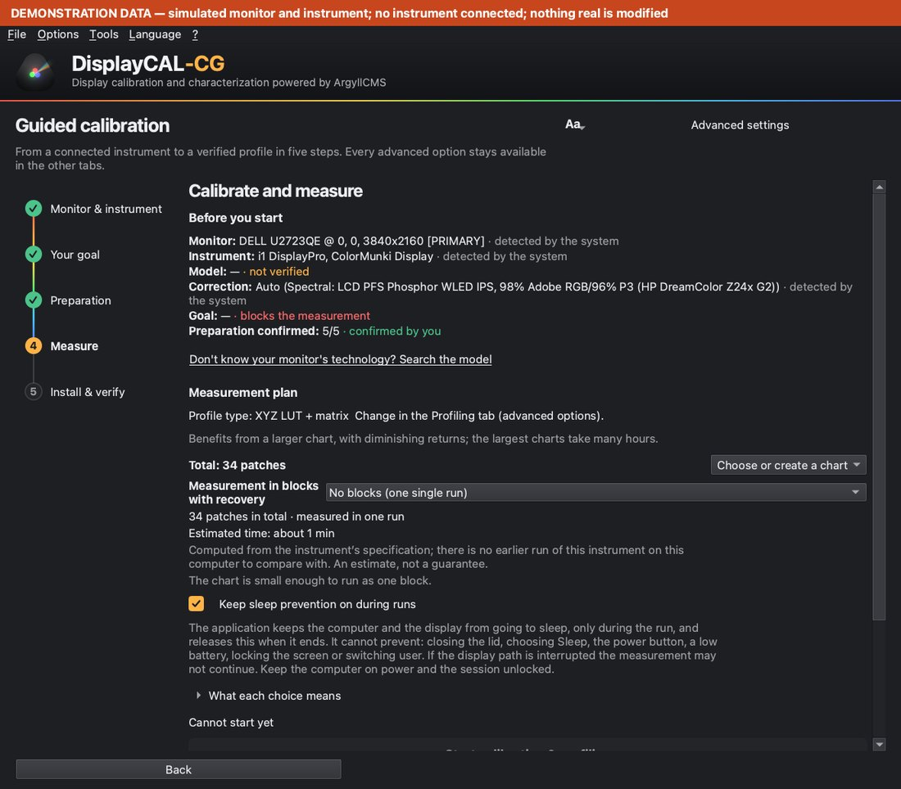
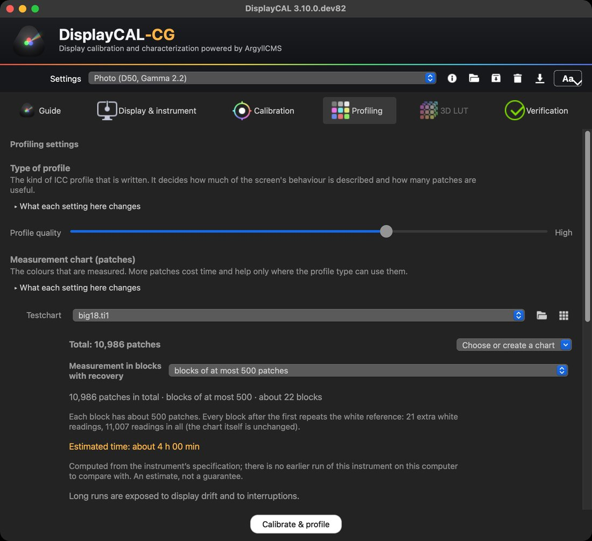

[🇷🇴 Română](README.md) · [🇬🇧 English](README.en.md) · [🇪🇸 Español](README.es.md)

<h1 align="center">DisplayCAL-CG</h1>

<b>Guided monitor calibration and profiling. On ArgyllCMS, free and open source.</b>

 

DisplayCAL-CG takes you from the probe to a verified ICC profile in five steps: what to prepare, how to place the instrument, how long it takes, and what happens if something stops. It is an edition of [DisplayCAL](https://displaycal.net) maintained by Cristi Gordaș (the community continuation is [displaycal-py3](https://github.com/eoyilmaz/displaycal-py3)), on the same code and the same GPLv3 licence. **100% free: no trial, no activation, no paid features.**

 The “Measurement” step: the plan with total patches, block size, number of blocks and estimated time.

## What it does

It measures how your screen shows colour and writes an ICC profile that the system and your programs use for correct colour. It is for photographers, colourists, designers and anyone who needs a monitor to look the same from one day to the next and from one program to another.

**What you need:** a colorimeter or spectrophotometer supported by ArgyllCMS (for example from the i1Display, ColorMunki or Spyder families). Without a physical instrument nothing can be measured; the application does not simulate measurements.

## What the CG edition adds to the original project

- **Guided calibration** in five steps (monitor and instrument, goal, preparation, measurement, install and verify), with a Qt interface. Advanced mode stays, regrouped by decision, on the same configuration.
- **Sourced preparation and probe placement**, with a schematic animation for instruments the maker documents; you confirm the exact model when several products share one USB identity.
- **The measurement plan before you start**: total patches, block size, number of blocks and estimated time, shown separately; choosing or creating the chart beside the total.
- **Measurement in blocks with recovery**: finished blocks are saved locally, there is a session journal and a way to continue with the remaining blocks (only under the same conditions), and sleep is prevented only while a run is active. Sessions of several hours have not been validated yet; none of this guarantees stability.
- **Local diagnostics**: rotating logs and a package export with redaction by default, never sent automatically.
- **Adjustable text** (“Aa”), checked contrast, Romanian/English/Spanish interface; **ArgyllCMS included** and verified against a fixed SHA-256 hash; native installers.

 Advanced mode, Profiling tab, same configuration.

## Download

Downloads and the overview page are at **[gordas.dev/DisplayCAL-CG](https://gordas.dev/DisplayCAL-CG/en/)**; published versions are under [Releases](https://github.com/gordasgdc/displaycal-py3/releases).

| Platform | File | Notes |
|---|---|---|
| macOS (Apple Silicon) | `DisplayCAL-CG.dmg` / `.pkg` | Developer ID signed and notarized |
| Windows (x64) | `DisplayCAL-CG-Setup.exe` | not yet signed with a paid certificate: SmartScreen may warn |

## Requirements and limits

- An ArgyllCMS-supported measuring instrument.
- Verified: the macOS installers, a clean install on Windows 11 (ARM64 VM with x64 emulation), a short real measurement (38 patches) with an i1Display colorimeter on macOS.
- **Not verified**: multi-hour sessions, unplugging the probe during a measurement and recovery after a power cut, Windows on native x64 hardware, macOS on Intel, instruments other than the one tested, review of the translations by native speakers.

## Guide, support, issues

- [Detailed technical guide](https://gordas.dev/DisplayCAL-CG/en/guide/) (EN) · [PDF](docs/DisplayCAL-CG_Guide_EN.pdf)
- Install instructions: [macOS](docs/install_instructions_macos.md) · [Windows](docs/install_instructions_windows.md) · [Linux](docs/install_instructions_linux.md)
- Diagnostics: **? → Diagnostics and support** in the application builds a package locally that you attach to an issue yourself; nothing is sent automatically.
- [Report a problem](https://github.com/gordasgdc/displaycal-py3/issues/new)

## Licence and credits

GPLv3 (see [LICENSE.txt](LICENSE.txt)). The application may show the original project's optional support message; you can close it.

- **DisplayCAL** — Florian Höch, the original author.
- **displaycal-py3** — the community continuation (the Python 3 port).
- **ArgyllCMS** — Graeme Gill, the measurement and profile engine.
- **DisplayCAL-CG** — adaptations, guided interface and installers: Cristi Gordaș.

What was selectively taken from the original project: [UPSTREAM_INTEGRATED.md](docs/UPSTREAM_INTEGRATED.md).

## Original project documentation

The original README and its instructions stay available: [README.upstream.en.md](docs/upstream/README.upstream.en.md) · [documentation](https://displaycal.net).

<a href="https://github.com/gordasgdc/displaycal-py3"><picture><source media="(prefers-color-scheme: dark)" srcset="docs/assets/site/github-invertocat-white.svg"></picture></a> If it helped you, a star helps the project get found. <a href="https://github.com/gordasgdc/displaycal-py3">Give a star</a>

