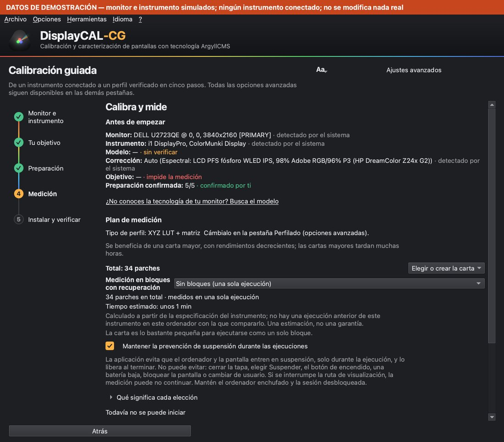
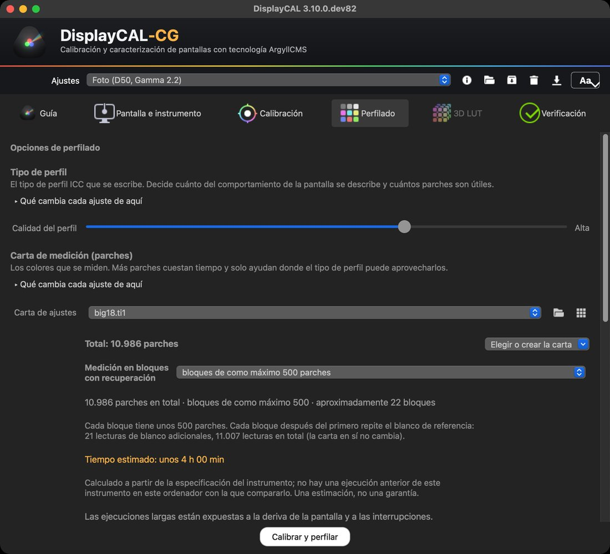

[🇷🇴 Română](README.md) · [🇬🇧 English](README.en.md) · [🇪🇸 Español](README.es.md)

<h1 align="center">DisplayCAL-CG</h1>

<b>Calibración y perfilado de monitor, guiados. Sobre ArgyllCMS, gratis y de código abierto.</b>

 

DisplayCAL-CG te lleva de la sonda a un perfil ICC verificado en cinco pasos: qué preparar, cómo colocar el instrumento, cuánto tarda y qué pasa si algo se detiene. Es una edición de [DisplayCAL](https://displaycal.net) mantenida por Cristi Gordaș (la continuación de la comunidad es [displaycal-py3](https://github.com/eoyilmaz/displaycal-py3)), sobre el mismo código y la misma licencia GPLv3. **100% gratis: sin prueba, sin activación, sin funciones de pago.**

 El paso «Medición»: el plan con total de parches, tamaño del bloque, número de bloques y tiempo estimado.

## Qué hace

Mide cómo muestra el color tu pantalla y escribe un perfil ICC que el sistema y tus programas usan para un color correcto. Es para fotógrafos, coloristas, diseñadores y cualquiera que necesite que el monitor se vea igual de un día a otro y de un programa a otro.

**Qué necesitas:** un colorímetro o espectrofotómetro compatible con ArgyllCMS (por ejemplo de las familias i1Display, ColorMunki o Spyder). Sin un instrumento físico no se puede medir nada; la aplicación no simula mediciones.

## Qué aporta la edición CG al proyecto original

- **Calibración guiada** en cinco pasos (monitor e instrumento, objetivo, preparación, medición, instalar y verificar), con interfaz Qt. El modo avanzado se mantiene, reagrupado por decisión, con la misma configuración.
- **Preparación con fuentes y colocación de la sonda**, con una animación esquemática para los instrumentos que el fabricante documenta; el modelo exacto lo confirmas tú cuando varios productos comparten la misma identidad USB.
- **El plan de medición antes de empezar**: total de parches, tamaño del bloque, número de bloques y tiempo estimado, mostrados por separado; elegir o crear la carta junto al total.
- **Medición en bloques con recuperación**: los bloques terminados se guardan localmente, hay un diario de sesión y se puede continuar con los bloques restantes (solo en las mismas condiciones); el reposo se evita solo durante la ejecución. Las sesiones de varias horas todavía no se han validado; nada de esto garantiza estabilidad.
- **Diagnóstico local**: registros rotativos y exportación de un paquete con redacción por defecto, sin envío automático.
- **Texto ajustable** («Aa»), contraste comprobado, interfaz en rumano, inglés y español; **ArgyllCMS incluido** y verificado con una suma SHA-256 fija; instaladores nativos.

 Modo avanzado, pestaña Perfilado, la misma configuración.

## Descarga

Las descargas y la página de presentación están en **[gordas.dev/DisplayCAL-CG](https://gordas.dev/DisplayCAL-CG/es/)**; las versiones publicadas, en [Releases](https://github.com/gordasgdc/displaycal-py3/releases).

| Plataforma | Archivo | Notas |
|---|---|---|
| macOS (Apple Silicon) | `DisplayCAL-CG.dmg` / `.pkg` | firmado con Developer ID y notarizado |
| Windows (x64) | `DisplayCAL-CG-Setup.exe` | aún sin firmar con un certificado de pago: SmartScreen puede avisar |

## Requisitos y límites

- Un instrumento de medición compatible con ArgyllCMS.
- Verificado: los instaladores de macOS, una instalación limpia en Windows 11 (VM ARM64 con emulación x64), una medición real corta (38 parches) con un colorímetro i1Display en macOS.
- **No verificado**: sesiones de varias horas, desconexión de la sonda durante la medición y recuperación tras un corte de corriente, Windows en hardware x64 nativo, macOS en Intel, instrumentos distintos del probado, revisión de las traducciones por hablantes nativos.

## Guía, soporte, incidencias

- [Guía técnica detallada](https://gordas.dev/DisplayCAL-CG/es/guia/) (ES) · [PDF](docs/DisplayCAL-CG_Guia_ES.pdf)
- Instrucciones de instalación: [macOS](docs/install_instructions_macos.md) · [Windows](docs/install_instructions_windows.md) · [Linux](docs/install_instructions_linux.md)
- Diagnóstico: **? → Diagnóstico y soporte** en la aplicación crea un paquete en local que adjuntas tú a una incidencia; no se envía nada automáticamente.
- [Informar de un problema](https://github.com/gordasgdc/displaycal-py3/issues/new)

## Licencia y créditos

GPLv3 (ver [LICENSE.txt](LICENSE.txt)). La aplicación puede mostrar el mensaje opcional de apoyo del proyecto original; puedes cerrarlo.

- **DisplayCAL** — Florian Höch, el autor original.
- **displaycal-py3** — la continuación de la comunidad (el port a Python 3).
- **ArgyllCMS** — Graeme Gill, el motor de medición y de perfiles.
- **DisplayCAL-CG** — adaptaciones, interfaz guiada e instaladores: Cristi Gordaș.

Qué se tomó de forma selectiva del proyecto original: [UPSTREAM_INTEGRATED.md](docs/UPSTREAM_INTEGRATED.md).

## Documentación del proyecto original

El README original y sus instrucciones siguen accesibles: [README.upstream.es.md](docs/upstream/README.upstream.es.md) · [documentación](https://displaycal.net).

<a href="https://github.com/gordasgdc/displaycal-py3"><picture><source media="(prefers-color-scheme: dark)" srcset="docs/assets/site/github-invertocat-white.svg"></picture></a> Si te ha sido útil, una estrella ayuda a que el proyecto se encuentre. <a href="https://github.com/gordasgdc/displaycal-py3">Dar una estrella</a>

