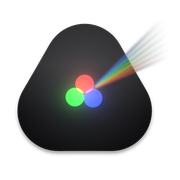
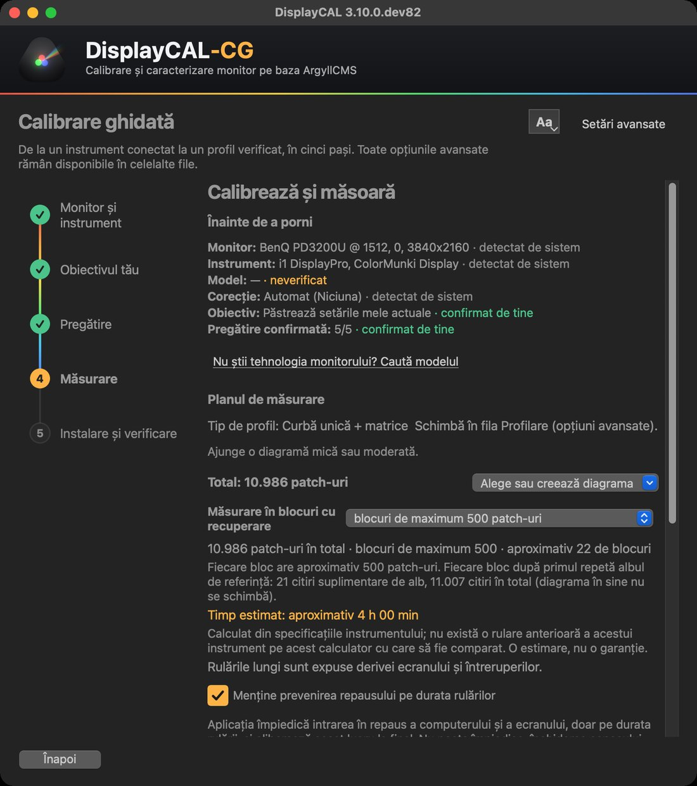
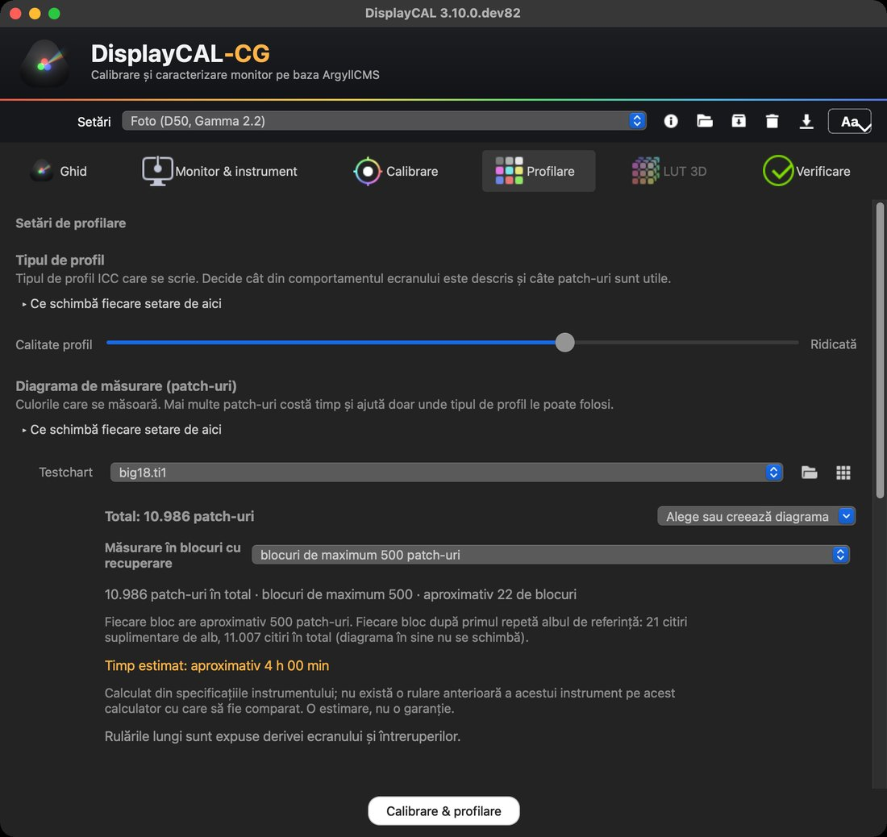

[🇷🇴 Română](README.md) · [🇬🇧 English](README.en.md) · [🇪🇸 Español](README.es.md)

<h1 align="center">DisplayCAL-CG</h1>

<b>Calibrare și profilare de monitor, ghidată. Peste ArgyllCMS, gratuit și open source.</b>

 

DisplayCAL-CG te conduce de la sondă la un profil ICC verificat, în cinci pași: ce pregătești, cum așezi instrumentul, cât durează, ce se întâmplă dacă ceva se oprește. Este o ediție întreținută de Cristi Gordaș a proiectului [DisplayCAL](https://displaycal.net) (continuarea comunității: [displaycal-py3](https://github.com/eoyilmaz/displaycal-py3)), peste același cod și aceeași licență GPLv3. **100% gratuit: fără trial, fără activare, fără funcții plătite.**

 Pasul «Măsurare»: planul cu totalul de patch-uri, mărimea blocului, numărul de blocuri și timpul estimat.

## Ce face

Măsoară cum își afișează ecranul culorile și scrie un profil ICC pe care sistemul și programele îl folosesc pentru culori corecte. Este pentru fotografi, coloriști, designeri și oricine are nevoie ca monitorul să arate la fel de la o zi la alta și de la un program la altul.

**Ce îți trebuie:** un colorimetru sau un spectrofotometru compatibil cu ArgyllCMS (de exemplu din familiile i1Display, ColorMunki sau Spyder). Fără instrument fizic nu se poate măsura nimic; aplicația nu simulează măsurători.

## Ce aduce ediția CG față de proiectul original

- **Calibrare ghidată** în cinci pași (monitor și instrument, obiectiv, pregătire, măsurare, instalare și verificare), cu interfață Qt. Modul avansat rămâne, regrupat pe decizii, cu aceeași configurație.
- **Pregătire cu surse și poziționarea sondei**, cu animație schematică pentru instrumentele documentate de producător; modelul exact îl confirmi tu când mai multe produse au aceeași identitate USB.
- **Planul de măsurare înainte de pornire**: total de patch-uri, mărimea blocului, numărul de blocuri și timp estimat, afișate separat; alegerea sau crearea diagramei lângă total.
- **Măsurare în blocuri cu recuperare**: blocurile terminate se salvează local, există un jurnal de sesiune și o reluare cu blocurile rămase (doar în aceleași condiții), iar repausul este împiedicat doar pe durata rulării. Sesiunile de mai multe ore nu au fost încă validate; nimic din aceasta nu garantează stabilitatea.
- **Diagnostic local**: jurnale rotative și export de pachet cu redactare implicită, fără trimitere automată.
- **Text redimensionabil** («Aa»), contrast verificat, interfață în română, engleză și spaniolă; **ArgyllCMS inclus** și verificat cu o sumă SHA-256 fixă; instalatoare native.

 Modul avansat, fila Profilare, aceeași configurație.

## Descărcare

Descărcările și pagina de prezentare sunt la **[gordas.dev/DisplayCAL-CG](https://gordas.dev/DisplayCAL-CG/)**; versiunile publicate sunt la [Releases](https://github.com/gordasgdc/displaycal-py3/releases).

| Platformă | Fișier | Note |
|---|---|---|
| macOS (Apple Silicon) | `DisplayCAL-CG.dmg` / `.pkg` | semnat Developer ID și notarizat |
| Windows (x64) | `DisplayCAL-CG-Setup.exe` | încă nesemnat cu un certificat plătit: SmartScreen poate avertiza |

## Cerințe și limite

- Un instrument de măsură compatibil ArgyllCMS.
- Verificat: instalatoarele macOS, instalarea curată pe Windows 11 (VM ARM64 cu emulare x64), o măsurare reală scurtă (38 de patch-uri) cu un colorimetru i1Display pe macOS.
- **Neverificat**: sesiuni de mai multe ore, deconectarea sondei în timpul măsurării și revenirea după o pană de curent, Windows pe hardware x64 nativ, macOS pe Intel, alte instrumente decât cel testat, revizuirea traducerilor de către vorbitori nativi.

## Ghid, suport, probleme

- [Ghid tehnic detaliat](https://gordas.dev/DisplayCAL-CG/ghid/) (RO) · [PDF](docs/DisplayCAL-CG_Ghid_RO.pdf)
- Instrucțiuni de instalare: [macOS](docs/install_instructions_macos.md) · [Windows](docs/install_instructions_windows.md) · [Linux](docs/install_instructions_linux.md)
- Diagnostic: **? → Diagnostic și suport** în aplicație creează local un pachet pe care îl atașezi tu la o problemă; nu se trimite nimic automat.
- [Raportează o problemă](https://github.com/gordasgdc/displaycal-py3/issues/new)

## Licență și credite

GPLv3 (vezi [LICENSE.txt](LICENSE.txt)). Aplicația poate afișa mesajul opțional de susținere al proiectului original; îl poți închide.

- **DisplayCAL** — Florian Höch, autorul original.
- **displaycal-py3** — continuarea comunității (portarea pe Python 3).
- **ArgyllCMS** — Graeme Gill, motorul de măsurare și de calcul al profilelor.
- **DisplayCAL-CG** — adaptări, interfață ghidată și pachete de instalare: Cristi Gordaș.

Ce a fost preluat selectiv din proiectul original: [UPSTREAM_INTEGRATED.md](docs/UPSTREAM_INTEGRATED.md).

## Documentația proiectului original

README-ul original (tradus) și instrucțiunile lui rămân accesibile: [README.upstream.md](docs/upstream/README.upstream.md) · [documentație](https://displaycal.net).

<a href="https://github.com/gordasgdc/displaycal-py3"><picture><source media="(prefers-color-scheme: dark)" srcset="docs/assets/site/github-invertocat-white.svg"></picture></a> Dacă ți-a fost de folos, o stea ajută proiectul să fie găsit. <a href="https://github.com/gordasgdc/displaycal-py3">Oferă o stea</a>

